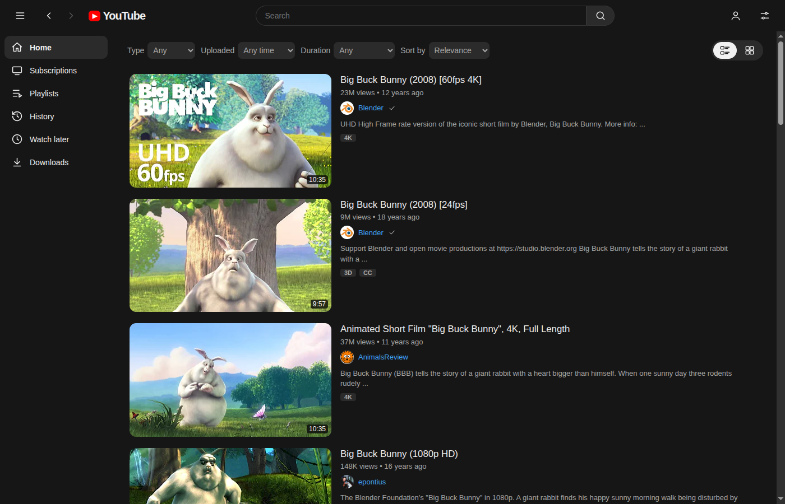

# YouTube Desktop

A desktop YouTube client (Electron) with its own UI, built on `youtubei.js` for browsing and `yt-dlp` for streams and downloads.

> Unofficial. Not affiliated with, endorsed by or sponsored by YouTube or Google. YouTube is a trademark of Google LLC.

## Download

Builds are on the Releases page, with SHA-256 checksums in `SHA256SUMS`:

- Windows: `YouTube-Desktop-<version>-Setup.exe` (installer) or `-Portable.exe`. `yt-dlp.exe` is bundled; merged downloads and MP3 conversion need `ffmpeg` on PATH. The files are unsigned, so SmartScreen will warn on first run.
- Linux: `.deb` (`sudo apt install ./youtube-desktop_<version>_amd64.deb`) or the AppImage.

## Run from source

    npm install
    npm start

Requires `yt-dlp` and `ffmpeg`. Keep yt-dlp current: YouTube breaks old builds. The app prefers `~/.local/bin/yt-dlp` over the system one.

## Features

- Search with filters and suggestions, channel pages, comments (read and post), related videos; paste any YouTube link into the search box
- Playback up to 4K with settings for resolution, frame rate, codec (H.264, VP9, AV1) and video/audio bitrate; audio-only mode; speed 0.25x to 3x
- Subtitles from yt-dlp with their own appearance settings (size, font, colors, edge, background)
- Downloads (video or audio) through yt-dlp: container, resolution, codec, MP3/M4A/Opus/FLAC/WAV, bitrate, embedded cover art, metadata and subtitles, sponsor-segment removal, file-name template, speed limit; whole playlists with progress and cancel
- Subscriptions in two layouts: grouped by day or channel (2016-2018 style) or a box with a channel list (2012 style); manage and import subscriptions
- Playlists, history, watch later, resume playback
- SponsorBlock (per category), DeArrow, Return YouTube Dislike
- Sign in with Google's device-code page, switch accounts and channels, notifications, like/dislike, subscribe
- Mini player with size, screen corner, opacity, always-on-top and open-on-minimize settings; picture-in-picture; tray; media keys; global hotkey (Ctrl+Alt+Y)
- Player settings menu on the video (quality, speed, subtitles, sleep timer, buffer), sleep timer, buffer-ahead cache
- Own player control bar with six player themes, customizable player buttons, theater mode, comments in the side column or below the video, trackpad swipe for back and forward, page animations, Modern and Classic (2012) skins, themes (including custom colors), interface scale, spacing, thumbnail size, sidebar and related-video layout, custom CSS

All of it is configurable under Settings (gear icon).

On Linux with Wayland, apps cannot choose where their windows appear. Set Settings, General, Window system to X11 and restart for the mini player's corner and stay-on-top options to work.
